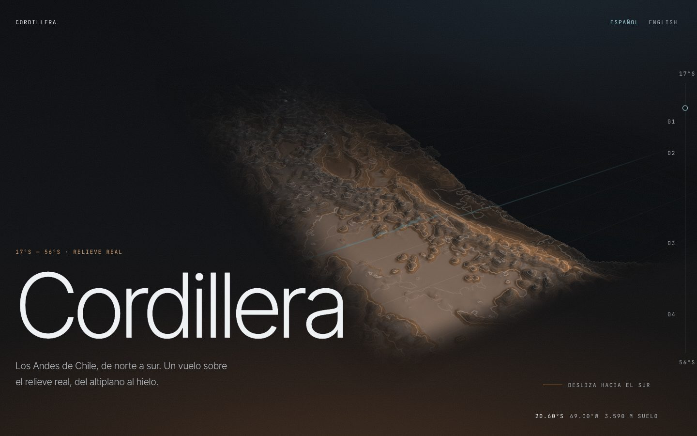
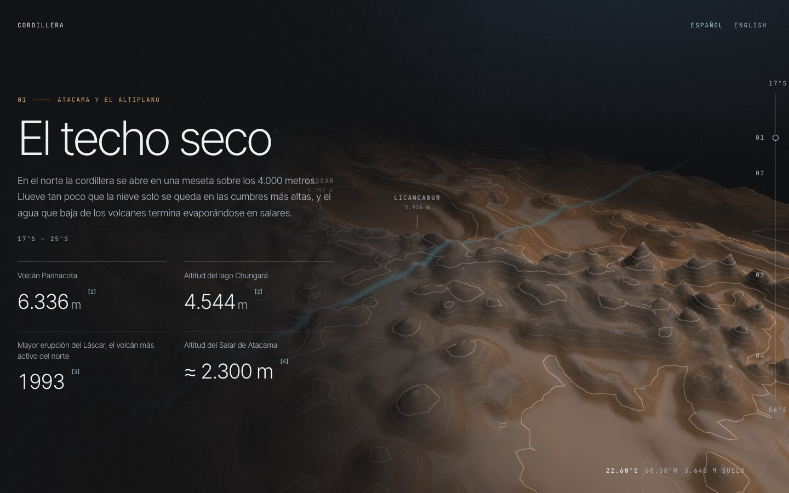
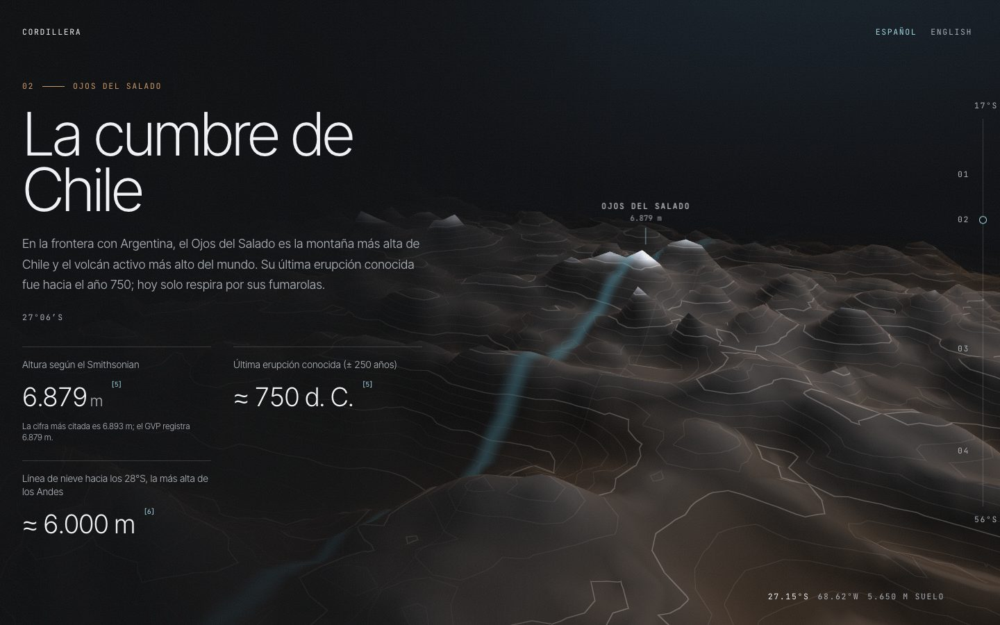
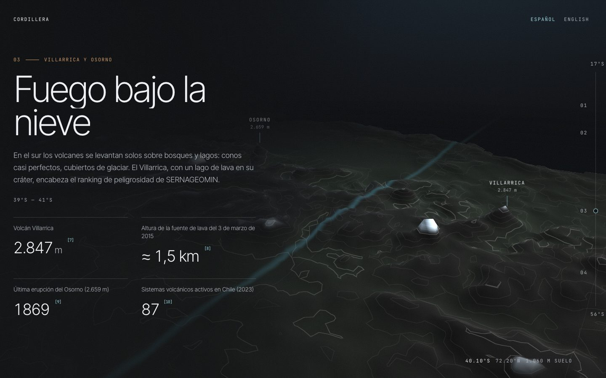
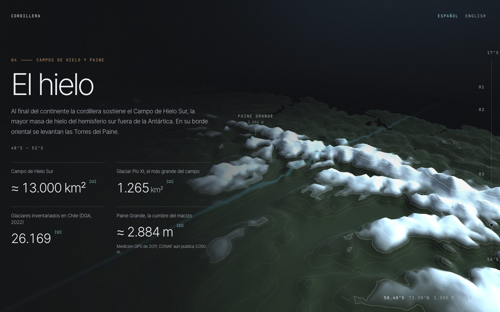
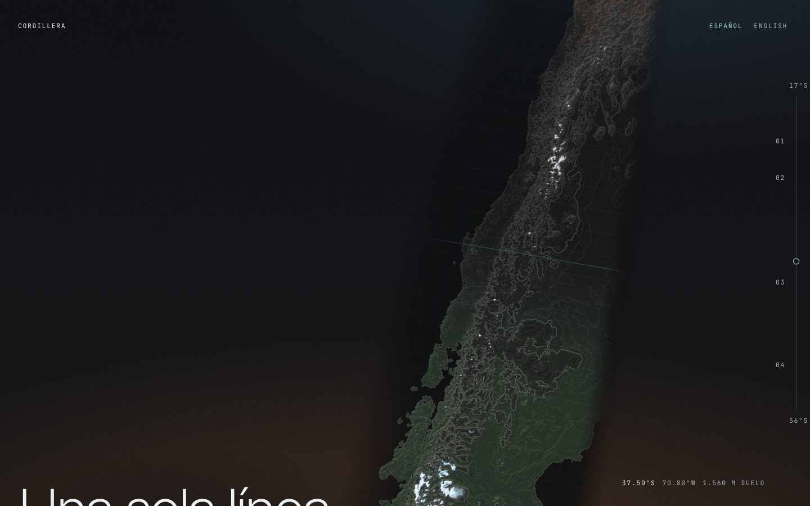
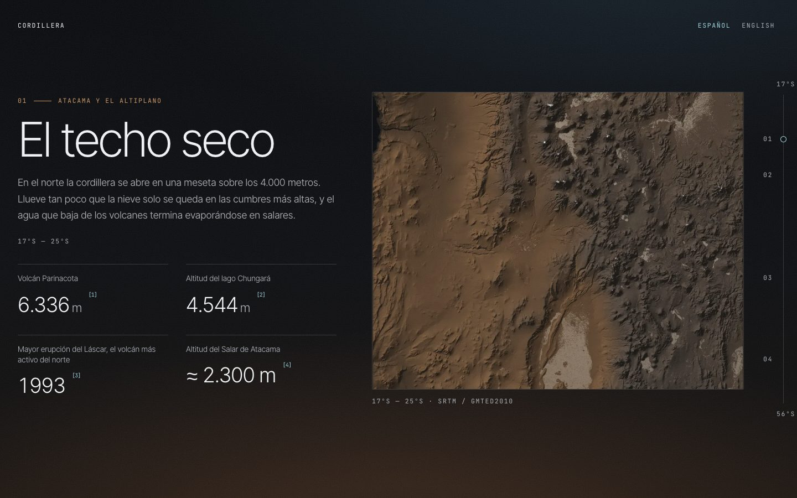
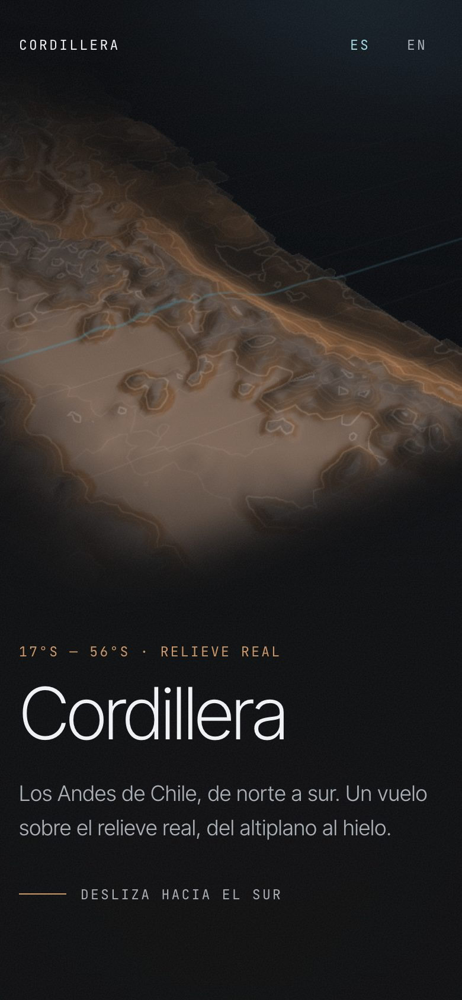
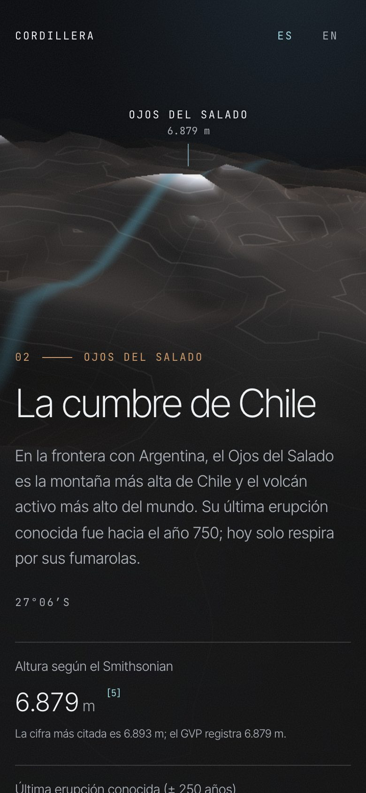

# Cordillera

A cinematic, scroll-driven flight over the Chilean Andes, north to south: the
altiplano and the Atacama, Ojos del Salado, the volcanoes of the lake
district, and the Patagonian ice fields. The terrain is real elevation data
rendered in WebGL; every figure on the page carries its source. Bilingual
(ES/EN), no backend.

It sits in a series with [Atacama](../Atacama) (the sky over Chile) and
[Epicentro](../Epicentro) (Chile's earthquakes): this one is the ground.



---

## Contents

- [The journey](#the-journey)
- [Stack](#stack)
- [Design direction](#design-direction)
- [Technical decisions](#technical-decisions)
- [Accessibility](#accessibility)
- [Performance](#performance)
- [Running it](#running-it)
- [Data and sources](#data-and-sources)

---

## The journey

Nine sections, each one a camera keyframe. The camera arrives at a keyframe
exactly when that section's text is centred on screen, and flies between
them while you scroll.

| # | Section | Where the camera is |
|---|---|---|
| — | Opening | high over the north, looking south along the range |
| 01 | Atacama and the altiplano | Licancabur, Láscar and the Salar de Atacama |
| — | Interlude | ≈ 500 km south |
| 02 | Ojos del Salado | low, close, the summit of Chile |
| — | Interlude | ≈ 1,370 km south, over central Chile |
| 03 | Villarrica and Osorno | snow-capped cones over the lakes |
| — | Interlude | ≈ 1,060 km south, the fjords |
| 04 | The ice | the Southern Patagonian Ice Field and Paine |
| — | Closing | the whole country from above, north up like a map |







The interludes carry one sentence and a distance. They exist for rhythm and
for the camera: thirteen hundred kilometres of flight need room to happen.

---

## Stack

| Purpose | Choice |
|---|---|
| Build | Vite 8 (Rolldown), static prerender of the HTML |
| UI | React 19, TypeScript 6 in strict mode |
| Styling | Tailwind CSS v4, tokens in `src/index.css` |
| 3D | three.js with a hand-written shader, lazy-loaded |
| Scroll | GSAP 3 + ScrollTrigger, Lenis, one shared `requestAnimationFrame` |
| Terrain pipeline | Node + `sharp` (`scripts/build-dem.mjs`) |
| Checks | `@axe-core/playwright`, Lighthouse, oxlint, Prettier |

Strictness is `strict` plus `noUncheckedIndexedAccess`,
`exactOptionalPropertyTypes`, `noImplicitOverride` and `noImplicitReturns`.

---

## Design direction

**«Basalto»: the range at night, lit by its own snow.** The reference was the
cinematic-site genre (dark grounds, a 3D scene as protagonist, shader
gradients, fine grain, large sober type, slow transitions), built here from
scratch around real data instead of a template.

- **The terrain colours itself by latitude and height**, the two things that
  decide what the Andes look like: the same 4,000 m is bare ochre rock in the
  Atacama and permanent ice in Patagonia. The snowline follows the real
  gradient (after Condom et al., 2007): about 6,000 m near 28°S, falling to
  about 1,000 m in the far south.
- **Contours every 250 m, heavier every 1,000 m**, drawn in the shader with
  `fwidth` anti-aliasing: the drawn-map layer over the rendered one.
- **A latitude cursor.** The parallel the camera is over glows in the accent,
  and the same latitude moves a cursor down the ruler on the right edge,
  which is also the table of contents.
- **Type:** Inter Tight at weight 260 for display, Inter Tight for text,
  JetBrains Mono for labels and figures (tabular numerals).
- **Grain:** a static SVG `feTurbulence` at 7.5 % over everything.

| Token | Hex | Role | Contrast on `basalto` |
|---|---|---|---|
| `--color-basalto` | `#0a0b0d` | ground | — |
| `--color-nieve` | `#eef1f3` | primary text | 18.1:1 |
| `--color-niebla` | `#a7adb4` | secondary text | 8.6:1 |
| `--color-ocre` | `#c99566` | structural: rules, labels | 7.4:1 |
| `--color-glaciar` | `#9fd6e4` | **interactive only**, and the latitude cursor | 12.1:1 |

Text never relies on the terrain behind it: chapters sit on a scrim that is
solid at the text and fades towards the relief.

---

## Technical decisions

**Real relief, small payload.** `scripts/build-dem.mjs` fetches AWS Terrain
Tiles at zoom 7 (190 tiles, cached locally), resamples them into one strip of
continental Chile in a *kilometre* grid (rows are latitude, columns are
kilometres from 71°W at that row's latitude, so Patagonia keeps its real
width instead of the equirectangular stretch) and writes raw `Uint16` heights:
`dem-256.bin` (256 × 982, 4.4 km cells, 491 KB) for capable screens and
`dem-128.bin` (128 × 491, 8.8 km, 123 KB) for phones. Raw binary rather than
PNG, because a browser is free to colour-manage a PNG on decode and silently
change the heights. Downsampling leans towards the maximum of each cell so
summits survive.

**The scene does not know about React.** `src/scene/relief.ts` takes a
continuous stage value (section index plus progress) and a pointer position,
and damps towards both on GSAP's ticker, the same `requestAnimationFrame` as
Lenis and ScrollTrigger. A flick of the wheel becomes a camera move instead of
a cut. Distances interpolate in log space, so going from orbit to a valley
feels even.

**Quality tiers.** Phones and modest machines get the coarse grid, no
antialiasing, a pixel-ratio cap of 1.25 and frames only while the camera is
moving. Capable desktops get the fine grid, antialiasing, a 1.75 cap and a
slow ambient drift. Rendering stops when the tab is hidden.

**Framing per viewport.** The camera's view offset moves the subject away
from the text: up on phones, where the text sits at the bottom; right on wide
screens, where it sits on the left.

**Lazy 3D.** three.js (118 KB gzip) and the grid are requested only after the
page has loaded and the main thread is idle. The first paint is prerendered
HTML and CSS.

**Prerendered HTML.** The build renders the app once with `renderToString`
and injects it into `dist/index.html`, so the title (the LCP element) paints
before React runs. The page hydrates in Spanish and applies the stored or
browser language in a layout effect, before the first paint and without a
hydration mismatch.

**No pins.** Chapters on wide screens are CSS `position: sticky`; nothing is
pinned by ScrollTrigger, so there are no spacers to measure and nothing to
drift. The camera is driven by section anchors measured on every refresh.

**Bilingual without drift.** Every user-visible string is a `{ es, en }` pair
side by side in `src/data/`. Numbers go through `Intl.NumberFormat`, counters
included, and counters write to React's own text node so a language switch
mid-count still updates.

**Sources cannot drift.** Each figure references a source id; the closing
numbers sources in order of first appearance from the same array the `[n]`
links use.

---

## Accessibility

- axe-core: **0 violations** in five builds (desktop ES and EN, phone ES,
  reduced motion desktop ES, reduced motion phone EN), `npm run a11y`.
- **Reduced motion is a different build, not a frozen one.** With
  `prefers-reduced-motion` (or `?reduced=1` in the URL) three.js is never
  loaded, Lenis never starts and each chapter shows a shaded-relief map
  rendered from the same data at zoom 9, with alt text. The same posters are
  the fallback when WebGL2 is unavailable or the scene fails to load.

  

- The 3D layer, its labels and the camera readout are `aria-hidden`:
  everything they show is also in the text.
- Headings that animate word by word are read whole (the split words are
  hidden, the sentence sits beside them).
- Only `transform` animates on content; nothing waiting below the fold starts
  transparent.
- `lang` follows the language switch; the page title too.
- Skip link, visible 2 px focus ring in the accent, 44 px touch targets for
  the language switch, 24 px for citation links.

---

## Performance

Lighthouse 12 against `vite preview` (no compression; Vercel adds it):

| Run | Performance | Accessibility | Best practices | SEO |
|---|---|---|---|---|
| Desktop | 100 | 100 | 100 | 100 |
| Mobile (simulated 4× CPU, slow 4G) | 95 | 100 | 100 | 100 |

Mobile: LCP 2.3 s, TBT 80 ms, CLS 0. Before the prerender, the title waited
for React and LCP was 3.8 s.

Against the live deploy (https://cordillera-chile.vercel.app, 2026-10-25):
desktop 100/100/100/100, mobile 93/100/100/100 (LCP 2.4 s, TBT 80 ms, CLS 0),
and axe still at 0 violations in all five builds.

---

## Running it

```bash
npm install
npm run dev
```

| Script | What it does |
|---|---|
| `npm run dev` | dev server on `:5173` |
| `npm run build` | typecheck, client build, SSR build, prerender |
| `npm run preview` | serve the production build |
| `npm run lint` | oxlint |
| `npm run format` | Prettier |
| `npm run dem` | rebuild `public/relief/` from elevation tiles |
| `npm run capture` | regenerate `docs/` and `public/og.jpg` (needs `npm run dev`) |
| `npm run a11y` | axe over every build (needs `npm run preview -- --port 4173`) |

`?reduced=1` forces the reduced-motion build; `?reduced=0` forces motion.

### Deploying

Live at **https://cordillera-chile.vercel.app** (`cordillera.vercel.app` was
already taken by another account). The Vercel project `cordillera-chile` is
connected to this repository, so every push to `main` deploys to production.
`vercel.json` sets the Vite preset, `dist`, a long cache for hashed assets and
a week for the terrain files. No environment variables, no runtime.




---

## Data and sources

**Terrain:** [AWS Terrain Tiles](https://registry.opendata.aws/terrain-tiles/)
(Mapzen/Tilezen terrarium encoding), which combine SRTM, GMTED2010, ETOPO1 and
other open datasets; see the
[Tilezen attribution](https://github.com/tilezen/joerd/blob/master/docs/attribution.md).
Height is exaggerated 6× in the scene. The page's figures come from the
sources below, never from the mesh.

**Figures** (all listed, numbered, in the closing of the page):

- Smithsonian Global Volcanism Program: [Parinacota](https://volcano.si.edu/volcano.cfm?vn=355012), [Licancabur](https://volcano.si.edu/volcano.cfm?vn=355092), [Láscar](https://volcano.si.edu/volcano.cfm?vn=355100), [Ojos del Salado](https://volcano.si.edu/volcano.cfm?vn=355130), [Villarrica](https://volcano.si.edu/volcano.cfm?vn=357120), [Osorno](https://volcano.si.edu/volcano.cfm?vn=358010)
- [Herrera et al. (2006)](https://www.redalyc.org/pdf/1739/173918421005.pdf), Lago Chungará
- [Copernicus](https://www.copernicus.eu/en/node/5934), Salar de Atacama
- [Condom et al. (2007)](https://app.ingemmet.gob.pe/biblioteca/pdf/Amb-82.pdf), snowline in the Andes
- [Romero et al. (2018)](https://www.frontiersin.org/journals/earth-science/articles/10.3389/feart.2018.00098/full), Villarrica, 3 March 2015
- [SERNAGEOMIN hazard ranking 2023](https://www.theclinic.cl/2023/10/16/entregan-ranking-de-los-volcanes-mas-peligrosos-de-chile-villarrica-encabeza-la-lista/) (press report)
- [Casassa & Rivera (2002)](https://glaciologia.cl/wp-content/uploads/2020/08/Casassa_Rivera2002.pdf), Patagonian ice fields
- [DGA glacier inventory 2022](https://www.glaciareschilenos.org/en/?p=21488)
- [Cordillera Paine](https://en.wikipedia.org/wiki/Cordillera_Paine) and [CONAF](https://www.conaf.cl/parques/parque-nacional-torres-del-paine/), Paine Grande
- [Memoria Chilena](https://www.memoriachilena.gob.cl/602/w3-article-94271.html), length of Chile

**Where sources disagree, the page says so.** Ojos del Salado is shown at the
GVP's 6,879 m with a note that 6,893 m is the most quoted figure; Paine Grande
at the 2011 GPS survey's 2,884 m with a note that CONAF still publishes
3,050 m. The count of active volcanoes is SERNAGEOMIN's 2023 figure (87); older
editions said 92.
